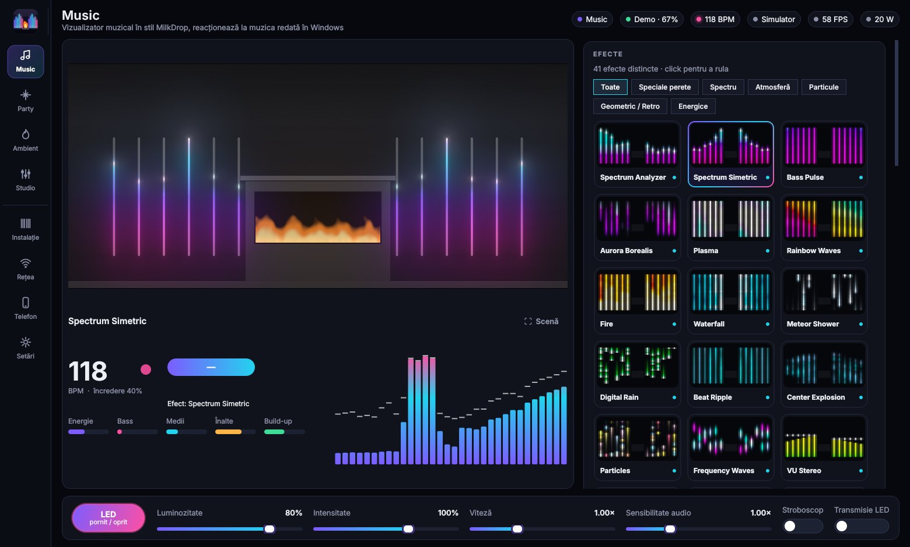
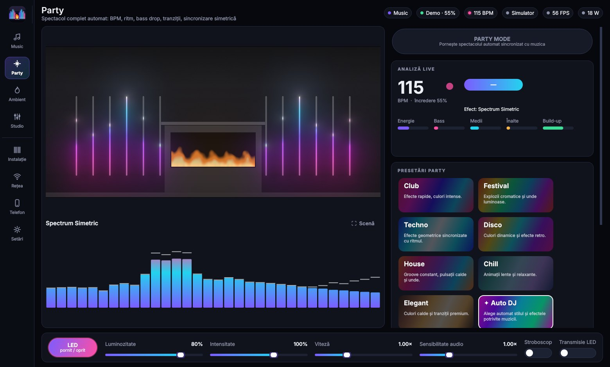
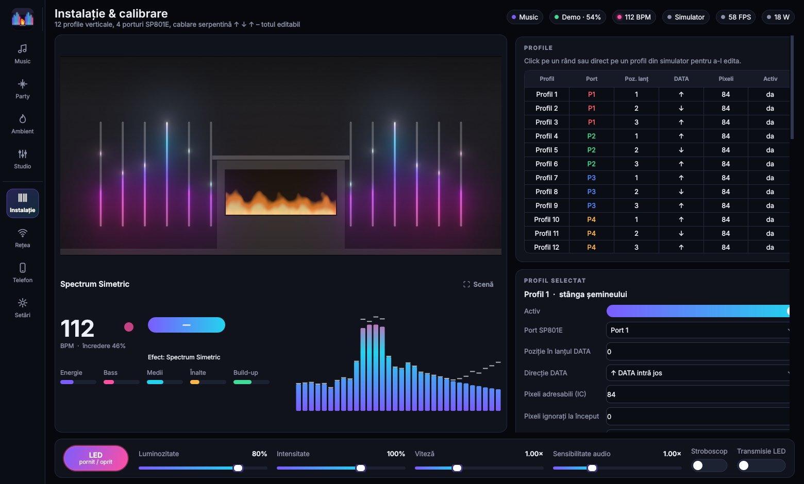
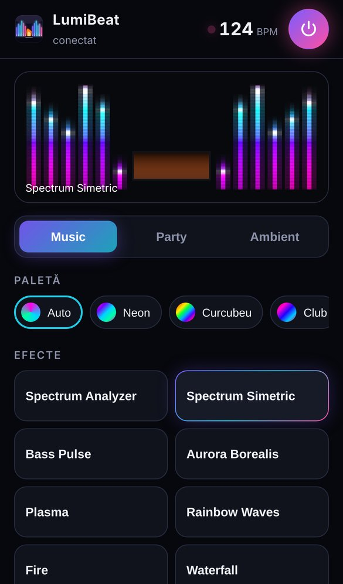

# LumiBeat Studio

Vizualizator muzical în stil Winamp MilkDrop și controler LED pentru Windows 11, făcut pentru un perete cu **12 profile LED verticale** (6 + 6 în jurul șemineului), bandă COB **WS2811** și controler **BanlanX SP801E** (Art-Net prin WiFi).



## Funcționalități

- **Simulator live al peretelui** randat pe GPU (OpenGL/GLSL): difuzor, profil de aluminiu, lumina reflectată pe perete, șemineu animat. Poți încărca o **fotografie reală** a peretelui și poziționa profilele peste ea. Simulatorul funcționează și fără instalația conectată.
- **52 de efecte** (41 muzicale, dintre care 8 create pentru peretele tău, plus 11 scene ambient), fiecare cu algoritm propriu: Spectrum Analyzer, Spectrum simetric, Bass Pulse, Aurora Borealis, Plasma, Rainbow Waves, Fire, Waterfall, Meteor Shower, Digital Rain, Beat Ripple, Center Explosion, Particles, Frequency Waves, MilkDrop Warp, Tunel, Lava Lamp, Caleidoscop, Glitch, Fulgere, Disco Ball… Efectele speciale pentru perete: Explozie din șemineu, Unde stânga–dreapta, Egalizator simetric 6 + 6, Flăcări digitale, Ploaie luminoasă, Pulsații verticale/orizontale, Cinematic.
- **Party / Auto DJ**: BPM, bătăi, kick, bass, medii, înalte, build-up, breakdown, **bass drop**, normalizare automată (AGC), filtrare zgomot, tranziții fluide, sincronizare simetrică stânga/dreapta, standby ambiental când muzica se oprește. Presetări: Club, Festival, Techno, Disco, House, Chill, Elegant și Auto DJ.
- **Ambient**: Fireplace, Warm White, Golden Hour, Northern Lights, Ocean, Forest, Sunset, Relax, Cinema, Night, Culoare fixă, cu temperatură de culoare simulată RGB.
- **Studio**: efecte personalizate din până la 4 straturi, cu salvarea, exportul și importul presetărilor.
- **Captură audio**: WASAPI Loopback (tot ce redă Windows: Spotify, YouTube, VLC, browser…), microfon sau intrare externă, plus o piesă demo internă.
- **Art-Net către SP801E**: descoperire ArtPoll, IP manual, mapare porturi → universuri (fără a presupune un univers pe port), ordine RGB, compensarea cablării serpentină ↑ ↓ ↑, teste per profil și per pixel, numărarea pixelilor reali, limitator de luminozitate și putere, rată adaptivă, reconectare automată, oprire controlată cu blackout.
- **Control de pe telefon**: interfață web responsive pe rețeaua locală (PIN, cod QR, previzualizare live).
- Pornire automată opțională odată cu Windows, rulare în tray, o singură instanță.
- **Stroboscop dezactivat implicit**, cu avertisment la activare și protecție anti-flash.

| Party | Calibrare | Telefon |
|---|---|---|
|  |  |  |

## Descărcare

Fiecare push construiește aplicația pe un runner Windows (GitHub Actions → *Build Windows*). Artefactul **LumiBeat-Studio-Windows** conține:

- `LumiBeat-Studio-Setup-1.0.0.exe`: instalator (Inno Setup), cu scurtături, pornire automată opțională și regulă de firewall doar pentru rețeaua privată;
- `LumiBeat Studio.exe`: varianta portabilă, un singur fișier;
- `LumiBeat-Studio-folder.zip`: aplicația dezarhivată.

Un tag `v*` publică aceleași fișiere ca *Release*.

Instalare, configurarea SP801E și calibrarea pas cu pas: **[docs/MANUAL.md](docs/MANUAL.md)**. Ce s-a verificat despre controler: **[docs/SP801E.md](docs/SP801E.md)**.

## Rulare din surse

```bash
pip install -r requirements-dev.txt
python main.py            # aplicația
python main.py --demo     # cu piesa demo internă ca sursă audio
python main.py --selftest # test integrat (audio, efecte, Party, Art-Net, web, GUI)
python -m pytest
```

Build Windows local (pe Windows):

```bat
pyinstaller --noconfirm --clean packaging\lumibeat.spec
"C:\Program Files (x86)\Inno Setup 6\ISCC.exe" packaging\installer.iss
```

## Structura codului

```
lumibeat/
  app.py               pornire, instanță unică, logare, argumente
  core/
    config.py          configurația hardware editabilă (JSON în %APPDATA%)
    geometry.py        matricea virtuală 12 × N (rândul 0 = jos fizic)
    mapping.py         matrice → pixeli reali → universuri; direcție DATA, RGB, gamma, limitator putere
    artnet.py          ArtDmx / ArtPoll / ArtSync, reconectare, rată adaptivă
    compat.py          verificarea compatibilității SP801E
    engine.py          motorul de spectacol (thread propriu, 60 FPS), tranziții, protecție anti-flash
    party.py           directorul Party / Auto DJ
    controller.py      orchestrare (UI, telefon, audio, Art-Net)
    state.py presets.py autostart.py
  audio/
    capture.py         WASAPI Loopback (PyAudioWPatch), microfon, demo
    analysis.py        FFT, benzi, AGC, onset, BPM, fază bătăi, drop, build-up, liniște
    demo.py            piesă house procedurală de 124 BPM
  effects/             music.py, special.py, ambient.py, custom.py (Studio), transitions.py, palettes.py
  ui/                  PySide6: fereastra principală, simulator OpenGL, pagini, widget-uri
  web/                 FastAPI + interfața mobilă (static/)
packaging/             PyInstaller spec, Inno Setup, version info
tools/make_icon.py     generează iconița
```

Tehnologii folosite, toate gratuite și fără abonamente: Python, PySide6 (LGPL), NumPy, SciPy, PyOpenGL, FastAPI, Uvicorn, PyAudioWPatch (MIT), qrcode, PyInstaller, Inno Setup.
